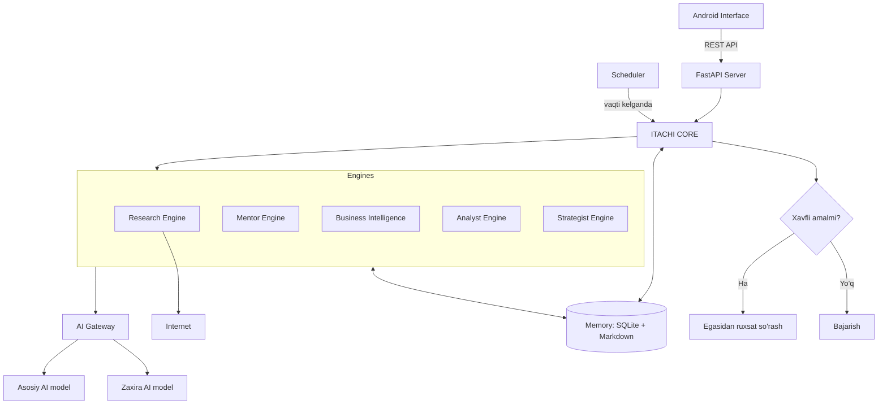

# ARCHITECTURE — Tizim arxitekturasi

> Holat: bu hujjat **reja**. Quyidagi modullarning hech biri hali yozilmagan.

## 1. Qisqacha

Project Itachi 2.0 — bitta server (backend) va unga ulanadigan Android ilovadan iborat. Server ichida markaziy "miya" (Itachi Core) bor. U vazifalarni mutaxassis modullarga (engine) beradi. Hamma modul bitta umumiy xotiradan foydalanadi va AI modellarga faqat AI Gateway orqali murojaat qiladi.

## 2. Umumiy diagramma



## 3. Qatlamlar

| Qatlam | Modullar | Vazifasi |
|---|---|---|
| Interfeys | Android Interface | Egasi bilan muloqot |
| Aloqa | FastAPI (REST API) | Ilova va server o'rtasidagi ko'prik |
| Boshqaruv | Itachi Core, Scheduler | Vazifalarni taqsimlash, vaqtida ishga tushirish |
| Mutaxassislar | Research, Mentor, BI, Analyst, Strategist | Har biri o'z sohasida ishlaydi |
| Xizmatlar | AI Gateway, Memory System | Hamma uchun umumiy |

## 4. Modullar qanday aloqa qiladi

- Ilova faqat FastAPI bilan gaplashadi, boshqa modullarni bevosita ko'rmaydi.
- Itachi Core vazifani qabul qilib, kerakli engine'ga beradi.
- Engine'lar AI modelga to'g'ridan-to'g'ri emas, faqat AI Gateway orqali murojaat qiladi. Model almashsa, engine'lar o'zgarmaydi.
- Hamma modul xotiraga Memory System orqali yozadi va undan o'qiydi.
- Scheduler vazifani Core'ga beradi, o'zi hech narsa hal qilmaydi.

## 5. Mustaqillik va ruxsat qoidasi

Agent o'zi qila oladi: ma'lumot izlash, tadqiqot, hisobot, tahlil, xotirani tartiblash, reja taklif qilish.

Egasidan ruxsat olishi **shart**: muhim kodni o'zgartirish, tashqi odamga xabar yuborish, pul sarflash, qaytarib bo'lmaydigan amal, xavfsizlik sozlamalarini o'zgartirish.

Bu qoida Core ichida "ruxsat darvozasi" (approval gate) sifatida bo'ladi. Batafsil: SECURITY.md.

## 6. Texnik qarorlar va sabablari

- **Python** — AI uchun eng keng tarqalgan til, o'rganish oson.
- **FastAPI** — Python'da API yaratishning sodda va bepul usuli.
- **SQLite** — oddiy bitta fayl, alohida server o'rnatish shart emas, bepul.
- **Markdown xotira** — odam ham o'qiy oladi, kerak bo'lsa qo'lda tahrirlash mumkin.
- **AI Gateway** — bitta model ishlamasa yoki pullik bo'lsa, boshqasiga o'tish uchun.
- **Scheduler** — egasi uxlayotganda ham rejalangan ishlar bajarilishi uchun.

## 7. Papka tuzilishi (reja)

```text
projekt-itachi-2.0/
  app/
    main.py        FastAPI kirish nuqtasi
    core/          Itachi Core
    engines/       research, mentor, business, analyst, strategist
    gateway/       AI Gateway
    memory/        Memory System
    scheduler/     Scheduler
  data/            SQLite fayl va Markdown xotira
  tests/           Sinovlar
  *.md             Hujjatlar
```

## 8. Hozirgi holat

- Ishlaydigan kod: yo'q
- Hujjatlar: README, ARCHITECTURE
- Keyingi: MODULES, DATABASE, API, SECURITY, DEVELOPMENT, ROADMAP, TASKS, CHANGELOG